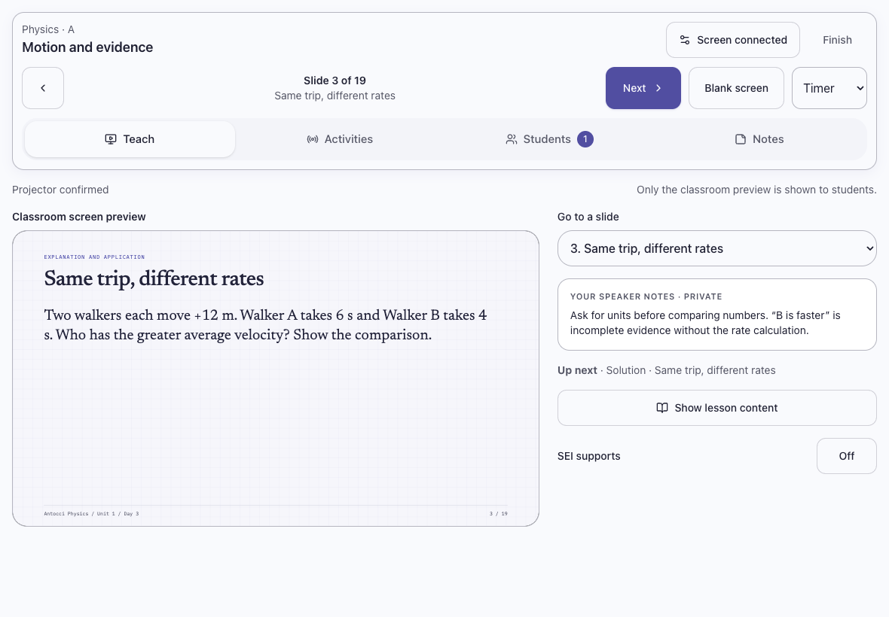

# Unit 1 decks in iPad Teach

The canonical Unit 1 lessons now select the rebuilt Teaching Edition decks at read time. The teacher lesson launcher, day-plan deck library, live presentation API, iPad Teach preview, and classroom projector use the same files. Days 11 and 12 use separate mass/force lab decks; Days 21 and 22 use separate assessment-session decks.

## Teaching flow

Choose the class and Unit 1 lesson in Teach and start or resume the presentation. Connect the classroom computer with **Open projector window**. The iPad shows the current classroom slide, the full slide chooser, private speaker notes, and the next slide. Questions and solutions have distinct slide labels. The existing timer, blackout, lesson-content projection, polls, group work, notes, reconnect, and finish controls remain available.

The new decks expose the same stage interface as the earlier exports. Session-controlled decks hide their local toolbar and wait for acknowledged navigation; the projector keyboard and iPad use the same session. Supplemental deck questions are notebook work. The old slide-index maps are removed from the resolved deck because the new slide sequence would make those maps incorrect. Authored section anchors are explicit; no proportional student-follow mapping is added.

## Scope and release

No database rows, lesson publication flags, student responses, mastery records, or assessment keys were changed. The source query found Days 19–22 unpublished; those release gates remain in effect. All 22 decks are available in the teacher day-plan library. The online student lessons use the current canonical BlockDocuments. The accompanying explainer integration adds six optional reference tools to canonical Unit 1 lessons; existing evidence and completion requirements remain intact.

The teacher-only transfer key and standalone self-study response storage were not copied into the application. Deck simulations retain their controls inside the authored deck; this change connects slide navigation and notes to Teach, not remote control of individual simulation parameters.

This work is included in the isolated teaching release with the explainer and textbook group-work integration. See PHYSICS_EXPLAINERS_GROUP_WORK_2026-09-23.md for the teaching flow and TEACHING_RELEASE_2026-09-23.md for release verification. The existing iPad teaching workspace changes in the working tree were preserved.

## Verification

- 22 distinct deck destinations; legacy single-day aliases; correct separation of combined lab/transfer files; old map removal without source-document mutation.
- Actual stored Unit 1 lesson identities resolve to existing rebuilt assets. The original deck-only resolver left CPA and Honors student documents unchanged. The subsequent explainer integration appends optional reference blocks idempotently without changing existing evidence blocks.
- Browser stage checks for all 22 rebuilt decks and five legacy examples; metadata parsing for 83 decks; 421 authored slides with notes; session-controlled navigation and toolbar hiding.
- TypeScript, targeted ESLint, and semantic style audit.
- Existing access/review and presentation API regressions.
- Full real-component iPad/projector journey with the rebuilt Day 3 deck: failed command recovery, private notes, lesson-content projection and restoration, blackout, timer, polls, groups, SEI, pulse/help tools, saved notes, reconnect, and finish. HTTP data was a controlled fixture; no production sessions or student work were created.
- Portrait 820×1180, landscape 1180×820, and split view 568×820 passed horizontal-overflow and 44px control checks. Physical iPad Safari and classroom Wi-Fi remain device checks.

Rules: A-1, A-2, A-4, A-6, P-1, P-2, P-4, P-6, M-1, C-3.
